# Diagrama de clases del dominio - SGA Hospeda (actualizado en la Entrega 3, paso J9)

El dominio es Java puro (sin Spring, JPA ni Lombok). Los agregados se referencian entre sí **solo por identificador**
(`Reserva` guarda `IdentificacionApartamento`; `Folio` guarda `CodigoReserva`).

**Cambios del paso J9 (Entrega 3)** (marcados con `«nuevo J9»`):
- `CanalVenta` (entidad, identidad por código): código único de 2 a 12 caracteres, nombre, `TipoCanalVenta`, hash de su `CredencialCanal` y `activo`. `desactivar()`/`activar()` son
  transiciones de negocio (409 si ya está en ese estado) y la baja es lógica. `identificadorPara(propio)` arma el identificador guardado (`CODIGO:propio`) y `esDeEsteCanal` reconoce el suyo.
- `CredencialCanal` (objeto de valor): `generar()` crea 256 bits aleatorios con prefijo `sgc_`; solo se guarda `hash` (SHA-256) y `toString()` no muestra el valor.
- `EventoCanal` (registro inmutable de la bitácora) con `OperacionCanal` y `ResultadoCanal`; `RegistroCanalVentaService` (servicio de dominio) hace único el código.
- `RechazoReservaExterna` gana identidad (`id`) y `RevisionRechazo` (nota obligatoria de a lo sumo 500 caracteres, quién y cuándo): `resolver(nota, por, ahora)` solo se puede una vez y **no toca ninguna reserva**.
- `MensajeRepetidoException` (subtipo de `ReglaDominioException`): RN-19 distingue "mismo mensaje" de "conflicto" para que la bitácora diga REPETIDA o RECHAZADA.
- Puertos `CanalVentaRepository` y `BitacoraCanalRepository`; `RechazoReservaExternaRepository` suma `buscarPorId` y `listar(revisado, pagina)`.

**Cambios del paso J8 (Entrega 3)** (marcados con `«nuevo J8»`):
- `Apartamento` tiene sus imágenes (7.3): `ImagenApartamento` (id, url, referencia en el almacén, `principal`, `retirada`). Reglas del agregado: a lo sumo 10 sin retirar;
  exactamente una principal cuando hay alguna (la primera lo es; elegir otra o retirar la principal lo mantiene); el retiro es lógico; un apartamento activo conserva al menos
  una. `verificarCupoImagenes` se revisa ANTES de subir nada al almacén. `reconstruir(..., imagenes)` valida la coherencia.
- `ActivacionApartamentoService` exige además al menos una imagen para activar (después de las tarifas completas).
- Puerto `AlmacenImagenes` (guardar una imagen y devolver su URL y referencia) con `ContenidoImagen` (bytes + formato verificado por su firma: `TipoImagen` JPG, PNG o WEBP) y
  `ReferenciaImagen`. `ValidadorImagenes` aplica los tamaños máximos configurables (apartamento y foto de perfil). `AlmacenamientoImagenesException` NO es una regla del negocio.

**Cambios del paso J7 (Entrega 3)** (marcados con `«nuevo J7»`):
- Integración de salida de notificaciones (10.3.2-A): puertos `Notificador` (enviar un aviso; puede lanzar `NotificacionFallidaException`) y `BandejaNotificaciones`
  (constancia de los avisos intentados), con los objetos de valor `Notificacion` (tipo, destinatario opcional, asunto, mensaje, código de reserva opcional),
  `RegistroNotificacion` (+ estado ENVIADA, FALLIDA o SIN_CORREO), `CorreoElectronico` (se normaliza a minúsculas; formato validado) y los enums `TipoNotificacion` y
  `EstadoNotificacion`. `RedactorNotificaciones` redacta el aviso de reserva creada, confirmada y cancelada y el del código de recuperación. El dominio no conoce
  al proveedor ni a Spring Mail.
- `ContactoReservaRepository`: correo opcional que se da al reservar; es un dato de contacto, NO de la `Reserva` (el agregado no cambió).
- `CodigoRecuperacion` (7.2): entidad con su hash, su vencimiento, `usado` e intentos fallidos. Reglas: 6 dígitos, vigencia, **un solo uso**, tope de intentos; todo rechazo
  dice lo mismo. Puerto `CodigoRecuperacionRepository`.
- `BajaUsuarioService` (7.2): no se desactiva a un usuario que sea titular de reservas PENDIENTE, CONFIRMADA o EN_CURSO. El usuario sigue fuera del dominio (3.6): el
  puente es el documento y el servicio solo consulta `ReservaRepository`.

**Cambios del paso J6 (Entrega 3)** (marcados con `«nuevo J6»` en el diagrama):
- `Alojamiento` (L-01, L-02, L-12, L-16): nombre, descripción, ciudad, dirección, `Ubicacion` (latitud y longitud), horas de entrada y salida, normas de
  convivencia y política de mascotas. Hay uno solo por sistema (igualdad: toda instancia es "el mismo alojamiento"). Regla: la salida es anterior a la entrada.
  Puerto `AlojamientoRepository`. `ConfiguracionConAlojamiento` (infraestructura) hace que las horas editadas rijan de inmediato en las reglas.
- `ServicioAdicional` (L-17): código (identidad), nombre, descripción, `generaCargo`, valor en `Dinero` y baja lógica. Regla: genera cargo ⇒ valor > 0; cortesía ⇒ valor 0.
  Puerto `ServicioAdicionalRepository`; `RegistroServicioAdicionalService` (código único).
- `CargoServicioAdicionalService` (L-17, 7.7): carga el servicio al `Folio` solo si la reserva está CONFIRMADA o EN_CURSO, el servicio está activo y genera cargo y el folio está abierto.
- `RegistroPagoService` (L-18): el medio de pago debe estar en `ConfiguracionAlojamiento.mediosPagoAceptados()` (configuración, no código).
- `CalendarioOcupacionService` (7.1, 7.5) con `EstadoNoche` y `NocheCalendario`: estado de cada noche (LIBRE, RESERVADA, BLOQUEADA), máximo de noches
  configurable (`calendarioMaximoNoches()`, 62).
- `ControlCapacidadService` (7.3): reservas activas que quedan por encima de una capacidad menor; solo informa.
- `ConfiguracionAlojamiento` gana `mediosPagoAceptados()` y `calendarioMaximoNoches()`.

**Cambios del dominio respecto a la Entrega 1** (marcados con `«nuevo»` o `«cambio»` en el diagrama):
- Nuevos: `Temporada`, `PoliticaCancelacion`, `Periodo`, `TramoRetencion`, `Ajuste`, y los servicios `CalendarioTemporadas`,
  `ActivacionApartamentoService`, `RetencionCancelacionService`, `ConfirmacionReservaService`, `RegistroBloqueoService`,
  `RegistroApartamentoService`, `RegistroPoliticaCancelacionService`, `RegistroTarifaService`, `RegistroSalidaService`
  (el folio debe estar cerrado para registrar la salida, 7.6).
- `Apartamento`: nace **inactivo** (7.4), con `activar`, `darDeBaja`, `actualizarDatos` y `reincorporarAlServicio`.
- L-06 (corrección de la Entrega 2): `Apartamento` gana `descripcion`, `dotacion` (lista de textos sin repetidos) y
  `caracteristicas` (conjunto del enum cerrado `Caracteristica`). `actualizarDatos` pasa a ser atómico sobre todos los
  datos y se agrega `tieneTodas(Set~Caracteristica~)`, que responde al filtro de búsqueda (el apartamento debe tener todas
  las pedidas). Nuevo objeto de valor `Caracteristica` (enum) y nuevo criterio de puerto `FiltroApartamentos`.
- `Folio`: nueva lista de **ajustes** (movimientos con signo, RN-16), `liquidarCancelacion` y `liquidarNoShow`.
- `RetencionCancelacionService`: además de la cancelación calcula la consecuencia del no-show con la política congelada.
- Vencimiento automático (RN-21): `Reserva.haVencido`, `PlazoConfirmacion.limiteDeCreacion` y `Folio.liquidarVencimiento`
  (reverso del alojamiento sin penalidad).
- Canal externo: `IdentificadorExterno`, `RecepcionReservaExternaService` (RN-19: canal + identificador únicos; solo los canales
  externos lo llevan), `Reserva.crear`/`reconstruir` con el identificador, `RechazoReservaExterna` (RN-18) y su puerto
  `RechazoReservaExternaRepository`; `ReservaRepository.buscarPorCanalEIdentificadorExterno`.
- `Reserva.modificarEstancia`: ahora rechaza reservas en curso, exige al titular entre los ocupantes y revalida RN-04.
  Sobrecarga que además recibe el apartamento destino (RN-14): `apartamento` deja de ser `final` y el cambio queda en el historial.
- `TiempoPreparacion.permiteEntradaElMismoDia(salida, entrada)`: compara con la ventana salida-entrada (RN-20).
- L-20 (reglas propias, corrección de la Entrega 2):
  - **RP-01 Estancia mínima por temporada:** objeto de valor `EstanciaMinimaPorTemporada` (mapa temporada → noches), evaluado en
    `CotizadorEstancia` porque este conoce la temporada de cada noche.
  - **RP-02 Descuento por estancia larga:** objeto de valor `PoliticaDescuentoEstanciaLarga` (decide el porcentaje) y
    `ValorCongelado` ampliado con `porcentajeDescuento`, `bruto()`, `descuento()` y `total()` (= bruto - descuento). El
    constructor de un solo argumento se conserva y equivale a 0 %.
  - **RP-03 Adulto responsable:** objeto de valor `EdadAdultoResponsable`, `Ocupante.esAdultoEn` y la invariante en
    `Reserva.crear` y `Reserva.modificarEstancia`, que ahora reciben la edad como parámetro (como ya reciben `ahora`).
  - `ConfiguracionAlojamiento` gana `estanciaMinimaPorTemporada()`, `nochesDescuentoEstanciaLarga()`,
    `porcentajeDescuentoEstanciaLarga()` y `edadAdultoResponsableAnios()`.
- Puertos nuevos o ampliados en `domain/repository`: paginación (`Pagina`, `SolicitudPagina`), `FiltroReservas` (con salidas previstas y nombre del titular),
  `FiltroApartamentos` (L-06, y estado operativo), `GeneradorCodigoReserva`, `TemporadaRepository`, `PoliticaCancelacionRepository`.

## Entidades y objetos de valor

```mermaid
classDiagram
    direction LR

    class Reserva {
        <<raíz de agregado>>
        -CodigoReserva codigo
        -IdentificacionApartamento apartamento
        -Estancia estancia
        -Ocupante titular
        -List~Ocupante~ ocupantes
        -CanalOrigen canalOrigen
        -IdentificadorExterno identificadorExterno «nuevo, RN-19»
        -ValorCongelado valor
        -VersionPolitica politica
        -EstadoReserva estado
        -LocalTime horaEstimadaLlegada
        -List~EventoReserva~ historial
        +crear(...)$ Reserva
        +indicarHoraEstimadaLlegada()
        +confirmar()
        +cancelar()
        +haVencido() boolean «nuevo»
        +vencer()
        +registrarLlegada()
        +registrarSalida()
        +declararNoShow()
        +modificarEstancia(apartamento?) Dinero «cambio»
    }

    class Apartamento {
        <<raíz de agregado>>
        -IdentificacionApartamento identificacion
        -String nombre
        -String descripcion «nuevo L-06»
        -int dormitorios
        -int capacidad
        -List~String~ dotacion «nuevo L-06»
        -Set~Caracteristica~ caracteristicas «nuevo L-06»
        -EstadoOperativo estadoOperativo
        -boolean activo
        +admite(int) boolean
        +tieneTodas(Set~Caracteristica~) boolean «nuevo L-06»
        +marcarOcupado()
        +liberar()
        +iniciarPreparacion()
        +marcarPreparado()
        +declararFueraDeServicio()
        +actualizarDatos() «nuevo»
        +activar() «nuevo»
        +darDeBaja() «nuevo»
        +reincorporarAlServicio() «nuevo»
    }

    class Folio {
        <<raíz de agregado>>
        -CodigoReserva reserva
        -List~Cargo~ cargos
        -List~Ajuste~ ajustes «nuevo»
        -List~Pago~ pagos
        -boolean cerrado
        +registrarCargo()
        +registrarAjuste() «nuevo»
        +registrarPago()
        +liquidarCancelacion() «nuevo»
        +liquidarNoShow() «nuevo»
        +liquidarVencimiento() «nuevo»
        +saldo() Dinero
        +cerrar()
    }

    class RechazoReservaExterna {
        <<«nuevo, RN-18»>>
        -CanalOrigen canalOrigen
        -IdentificadorExterno identificadorExterno
        -IdentificacionApartamento apartamento
        -Estancia estancia
        -String motivo
        -LocalDateTime rechazadaEn
    }

    class IdentificadorExterno {
        <<record «nuevo, RN-19»>>
        +String valor
    }

    class Bloqueo {
        -IdentificacionApartamento apartamento
        -Estancia rango
        -String motivo
        +afecta(Estancia) boolean
    }

    class Temporada {
        <<«nuevo»>>
        -String nombre
        -boolean base
        -List~Periodo~ periodos
        +reclama(LocalDate) boolean
        +seSolapaCon(Temporada) boolean
    }

    class PoliticaCancelacion {
        <<«nuevo»>>
        -VersionPolitica version
        -LocalDate vigenteDesde
        -List~TramoRetencion~ tramos
        +retencion(Dinero, Duration) Dinero
        +devolucion(Dinero, Duration) Dinero
    }

    class Ocupante {
        -DocumentoIdentidad documento
        -LocalDate fechaNacimiento
        -String nombre
        +edadA(LocalDate) int
        +esFacturableEn(Estancia, UmbralEdadFacturable) boolean
        +esAdultoEn(Estancia, EdadAdultoResponsable) boolean «nuevo L-20 RP-03»
    }

    class Estancia {
        <<record>>
        +LocalDate fechaEntrada
        +LocalDate fechaSalida
        +noches() int
        +seSolapaCon(Estancia) boolean
    }
    class ValorCongelado {
        <<record>>
        +List~CargoNoche~ detalle
        +int porcentajeDescuento «nuevo L-20 RP-02»
        +bruto() Dinero «nuevo»
        +descuento() Dinero «nuevo»
        +total() Dinero «cambio: bruto - descuento»
    }
    class EstanciaMinimaPorTemporada {
        <<record «nuevo L-20 RP-01»>>
        +Map~String,Integer~ minimos
        +minimoDe(String) int
        +verificar(List~CargoNoche~)
    }
    class PoliticaDescuentoEstanciaLarga {
        <<record «nuevo L-20 RP-02»>>
        +int nochesDesde
        +int porcentaje
        +porcentajePara(int) int
    }
    class EdadAdultoResponsable {
        <<record «nuevo L-20 RP-03»>>
        +int anios
    }
    class CargoNoche {
        <<record>>
        +LocalDate noche
        +String temporada
        +Dinero tarifaPorOcupante
        +int ocupantesFacturables
        +subtotal() Dinero
    }
    class Dinero {
        <<record>>
        +BigDecimal valor
    }
    class Cargo {
        <<record>>
    }
    class Pago {
        <<record>>
    }
    class Ajuste {
        <<record «nuevo»>>
        +String concepto
        +Dinero valor
    }
    class Periodo {
        <<record «nuevo»>>
    }
    class TramoRetencion {
        <<record «nuevo»>>
        +int horasAntelacionMinima
        +int porcentajeRetencion
    }
    class Tarifa {
        <<record>>
        +String temporada
        +Dinero valorPorOcupanteNoche
    }
    class Alojamiento {
        <<entidad «nuevo J6»>>
        -nombre
        -descripcion
        -ciudad
        -direccion
        -ubicacion
        -horaEntrada
        -horaSalida
        -normasConvivencia
        -politicaMascotas
        +actualizarDatos(...)
    }
    class Ubicacion {
        <<record «nuevo J6»>>
        latitud
        longitud
    }
    class ServicioAdicional {
        <<entidad «nuevo J6»>>
        -codigo
        -nombre
        -generaCargo
        -valor
        -activo
        +actualizarDatos(...)
        +darDeBaja()
        +activar()
    }
    class CodigoRecuperacion {
        <<entidad «nuevo J7»>>
        -correo
        -hash
        -expiraEn
        -usado
        -intentosFallidos
        +emitir(correo, hash, ahora, vigenciaMinutos)$
        +generarTexto(azar)$
        +consumir(coincide, ahora, intentosMaximos)
    }
    class CorreoElectronico {
        <<record «nuevo J7»>>
        valor
    }
    class Notificacion {
        <<record «nuevo J7»>>
        tipo
        destinatario
        asunto
        mensaje
        codigoReserva
        generadaEn
        +mensajeRegistrable()
    }
    class RegistroNotificacion {
        <<record «nuevo J7»>>
        estado
        detalle
        registradaEn
    }
    class TipoNotificacion {
        <<enum «nuevo J7»>>
        RESERVA_CREADA
        RESERVA_CONFIRMADA
        RESERVA_CANCELADA
        CODIGO_RECUPERACION
    }
    class EstadoNotificacion {
        <<enum «nuevo J7»>>
        ENVIADA
        FALLIDA
        SIN_CORREO
    }
    class ImagenApartamento {
        <<record «nuevo J8»>>
        id
        url
        referencia
        principal
        retirada
        +comoPrincipal()
        +retirar()
    }
    class ContenidoImagen {
        <<record «nuevo J8»>>
        nombre
        tipo
        bytes
        +de(nombre, bytes)$
    }
    class ReferenciaImagen {
        <<record «nuevo J8»>>
        url
        referencia
    }
    class TipoImagen {
        <<enum «nuevo J8»>>
        JPEG
        PNG
        WEBP
        +detectar(bytes)$
    }
    class NocheCalendario {
        <<record «nuevo J6»>>
        noche
        estado
        reserva
        estadoReserva
    }
    class EstadoNoche {
        <<enum «nuevo J6»>>
        LIBRE
        RESERVADA
        BLOQUEADA
    }

    class EstadoReserva {
        <<enum>>
        PENDIENTE
        CONFIRMADA
        EN_CURSO
        FINALIZADA
        CANCELADA
        NO_SHOW
    }
    class EstadoOperativo {
        <<enum>>
        PREPARADO
        OCUPADO
        PENDIENTE_PREPARACION
        EN_PREPARACION
        FUERA_DE_SERVICIO
    }
    class CanalOrigen {
        <<enum>>
        PORTAL
        DIRECTO
        EXTERNO
    }
    class Caracteristica {
        <<enum «nuevo L-06»>>
        TERRAZA
        BALCON
        VISTA_AL_PARQUE
        VISTA_PANORAMICA
        JACUZZI
        PARQUEADERO
        ACCESIBLE
    }

    Reserva "1" *-- "1" Estancia
    Reserva "1" *-- "1" ValorCongelado
    Reserva "1" *-- "1..*" Ocupante
    Reserva ..> EstadoReserva
    Reserva ..> CanalOrigen
    ValorCongelado "1" *-- "1..*" CargoNoche
    CargoNoche ..> Dinero
    Apartamento ..> EstadoOperativo
    Apartamento ..> Caracteristica : 0..* «nuevo L-06»
    Folio "1" *-- "1..*" Cargo
    Folio "1" *-- "0..*" Ajuste
    Folio "1" *-- "0..*" Pago
    Reserva "1" o-- "0..1" IdentificadorExterno
    RechazoReservaExterna "1" *-- "1" IdentificadorExterno
    RechazoReservaExterna "1" *-- "1" Estancia
    Bloqueo "1" *-- "1" Estancia
    Temporada "1" *-- "0..*" Periodo
    PoliticaCancelacion "1" *-- "2..*" TramoRetencion

    Alojamiento "1" *-- "1" Ubicacion
    ServicioAdicional "1" *-- "1" Dinero
    NocheCalendario ..> EstadoNoche

    Reserva ..> Apartamento : por IdentificacionApartamento
    Folio ..> Reserva : por CodigoReserva
    Bloqueo ..> Apartamento : por IdentificacionApartamento
    Reserva ..> PoliticaCancelacion : por VersionPolitica
```

## Servicios de dominio y puertos

Los servicios se registran como `@Bean` en `infrastructure/config/DomainServiceConfig` (el dominio no conoce Spring).
Cada uno existe porque su regla involucra **más de un agregado** y ninguno puede evaluarla solo.

```mermaid
classDiagram
    direction LR

    class DisponibilidadApartamentoService {
        RN-01 RN-02 RN-07 RN-20
    }
    class CotizadorEstancia {
        RN-05 RN-06
        RP-01 RP-02 «L-20»
    }
    class RetencionCancelacionService {
        <<nuevo>>
        RN-13
    }
    class ConfirmacionReservaService {
        <<nuevo>>
        L-11 RN-08 RN-09
    }
    class RecepcionReservaExternaService {
        <<servicio de dominio «nuevo, RN-19»>>
        +verificarRecepcion(CanalOrigen, IdentificadorExterno)
    }

    class RegistroBloqueoService {
        <<nuevo>>
        7.3
    }
    class CalendarioTemporadas {
        <<nuevo>>
        7.4
    }
    class ActivacionApartamentoService {
        <<nuevo>>
        7.4
    }
    class RegistroApartamentoService {
        <<nuevo>>
        L-04
    }
    class RegistroPoliticaCancelacionService {
        <<nuevo>>
        F-07
    }
    class RegistroTarifaService {
        <<nuevo>>
        7.4
    }
    class RegistroSalidaService {
        <<nuevo>>
        7.6 RN-17
    }

    class CargoServicioAdicionalService {
        <<nuevo J6>>
        L-17 7.7
    }
    class RegistroServicioAdicionalService {
        <<nuevo J6>>
        L-17
    }
    class RegistroPagoService {
        <<nuevo J6>>
        L-18
    }
    class CalendarioOcupacionService {
        <<nuevo J6>>
        7.1 7.5
    }
    class ControlCapacidadService {
        <<nuevo J6>>
        7.3
    }
    class AlojamientoRepository { <<puerto «nuevo J6»>> }
    class ServicioAdicionalRepository { <<puerto «nuevo J6»>> }
    class AlmacenImagenes { <<puerto «nuevo J8»>> }
    class ValidadorImagenes { <<servicio «nuevo J8»>> }
    class Notificador { <<puerto «nuevo J7»>> }
    class BandejaNotificaciones { <<puerto «nuevo J7»>> }
    class ContactoReservaRepository { <<puerto «nuevo J7»>> }
    class CodigoRecuperacionRepository { <<puerto «nuevo J7»>> }
    class RedactorNotificaciones { <<servicio «nuevo J7»>> }
    class BajaUsuarioService { <<servicio «nuevo J7»>> }

    class ReservaRepository { <<puerto>> }
    class ApartamentoRepository { <<puerto>> }
    class FolioRepository { <<puerto>> }
    class BloqueoRepository { <<puerto>> }
    class RechazoReservaExternaRepository { <<puerto «nuevo»>> }
    class TarifarioRepository { <<puerto>> }
    class TemporadaRepository { <<puerto «nuevo»>> }
    class PoliticaCancelacionRepository { <<puerto «nuevo»>> }
    class GeneradorCodigoReserva { <<puerto «nuevo»>> }
    class ConfiguracionAlojamiento { <<puerto>> }

    DisponibilidadApartamentoService ..> ReservaRepository
    DisponibilidadApartamentoService ..> BloqueoRepository
    DisponibilidadApartamentoService ..> ConfiguracionAlojamiento
    CotizadorEstancia ..> TarifarioRepository
    CotizadorEstancia ..> ConfiguracionAlojamiento
    CotizadorEstancia ..> EstanciaMinimaPorTemporada
    CotizadorEstancia ..> PoliticaDescuentoEstanciaLarga
    Reserva ..> EdadAdultoResponsable : RP-03
    RetencionCancelacionService ..> ConfiguracionAlojamiento
    ConfirmacionReservaService ..> ConfiguracionAlojamiento
    RegistroBloqueoService ..> ReservaRepository
    RecepcionReservaExternaService ..> ReservaRepository
    ActivacionApartamentoService ..> TarifarioRepository
    ActivacionApartamentoService ..> TemporadaRepository
    RegistroApartamentoService ..> ApartamentoRepository
    RegistroPoliticaCancelacionService ..> PoliticaCancelacionRepository
    RegistroTarifaService ..> TemporadaRepository
    RegistroServicioAdicionalService ..> ServicioAdicionalRepository
    CargoServicioAdicionalService ..> ServicioAdicional
    CargoServicioAdicionalService ..> Folio
    RegistroPagoService ..> ConfiguracionAlojamiento
    CalendarioOcupacionService ..> ReservaRepository
    CalendarioOcupacionService ..> BloqueoRepository
    CalendarioOcupacionService ..> ConfiguracionAlojamiento
    ControlCapacidadService ..> ReservaRepository
    Apartamento "1" *-- "0..10" ImagenApartamento : galería (7.3)
    ContenidoImagen "1" o-- "1" TipoImagen
    AlmacenImagenes ..> ContenidoImagen
    AlmacenImagenes ..> ReferenciaImagen
    ValidadorImagenes ..> ContenidoImagen : tamaño máximo
    ActivacionApartamentoService ..> Apartamento : exige 1 imagen (7.3)
    RedactorNotificaciones ..> Reserva
    RedactorNotificaciones ..> Notificacion
    Notificacion "1" o-- "0..1" CorreoElectronico
    RegistroNotificacion "1" o-- "1" EstadoNotificacion
    Notificacion "1" o-- "1" TipoNotificacion
    CodigoRecuperacion "1" *-- "1" CorreoElectronico
    BajaUsuarioService ..> ReservaRepository : titular con reservas activas (7.2)
    Notificador ..> Notificacion
    BandejaNotificaciones ..> RegistroNotificacion
    CodigoRecuperacionRepository ..> CodigoRecuperacion
    ContactoReservaRepository ..> CorreoElectronico
```

