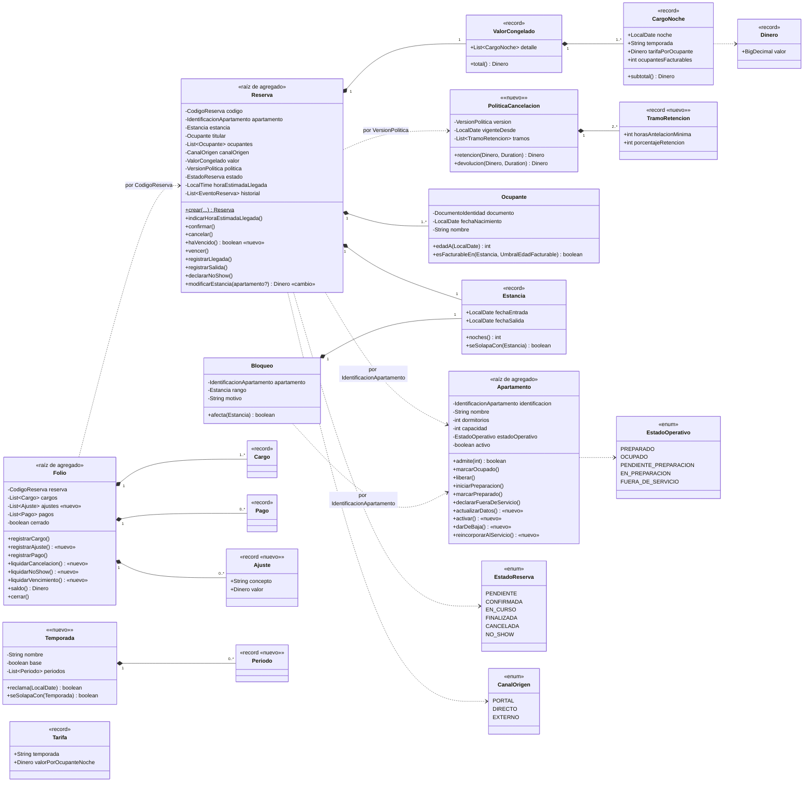
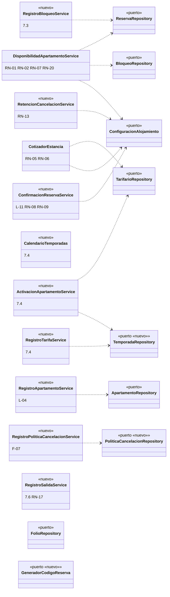

# Diagrama de clases del dominio - SGA Hospeda (actualizado en la Entrega 2)

El dominio es Java puro (sin Spring, JPA ni Lombok). Los agregados se referencian entre sí **solo por identificador**
(`Reserva` guarda `IdentificacionApartamento`; `Folio` guarda `CodigoReserva`).

**Cambios del dominio respecto a la Entrega 1** (marcados con `«nuevo»` o `«cambio»` en el diagrama):
- Nuevos: `Temporada`, `PoliticaCancelacion`, `Periodo`, `TramoRetencion`, `Ajuste`, y los servicios `CalendarioTemporadas`,
  `ActivacionApartamentoService`, `RetencionCancelacionService`, `ConfirmacionReservaService`, `RegistroBloqueoService`,
  `RegistroApartamentoService`, `RegistroPoliticaCancelacionService`, `RegistroTarifaService`, `RegistroSalidaService`
  (el folio debe estar cerrado para registrar la salida, 7.6).
- `Apartamento`: nace **inactivo** (7.4), con `activar`, `darDeBaja`, `actualizarDatos` y `reincorporarAlServicio`.
- `Folio`: nueva lista de **ajustes** (movimientos con signo, RN-16), `liquidarCancelacion` y `liquidarNoShow`.
- `RetencionCancelacionService`: además de la cancelación calcula la consecuencia del no-show con la política congelada.
- Vencimiento automático (RN-21): `Reserva.haVencido`, `PlazoConfirmacion.limiteDeCreacion` y `Folio.liquidarVencimiento`
  (reverso del alojamiento sin penalidad).
- `Reserva.modificarEstancia`: ahora rechaza reservas en curso, exige al titular entre los ocupantes y revalida RN-04.
  Sobrecarga que además recibe el apartamento destino (RN-14): `apartamento` deja de ser `final` y el cambio queda en el historial.
- `TiempoPreparacion.permiteEntradaElMismoDia(salida, entrada)`: compara con la ventana salida-entrada (RN-20).
- Puertos nuevos o ampliados en `domain/repository`: paginación (`Pagina`, `SolicitudPagina`), `FiltroReservas`,
  `GeneradorCodigoReserva`, `TemporadaRepository`, `PoliticaCancelacionRepository`.

## Entidades y objetos de valor

## Servicios de dominio y puertos

Los servicios se registran como `@Bean` en `infrastructure/config/DomainServiceConfig` (el dominio no conoce Spring).
Cada uno existe porque su regla involucra **más de un agregado** y ninguno puede evaluarla solo.

